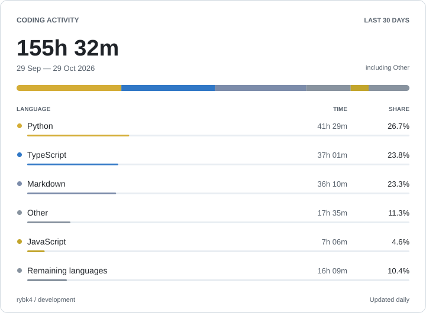

<!--START_SECTION:waka-->
<picture>
  <source media="(prefers-color-scheme: dark)" srcset="assets/wakatime-dark.svg">
  <source media="(prefers-color-scheme: light)" srcset="assets/wakatime-light.svg">
  
</picture>
<!--END_SECTION:waka-->
